<div align="center">

<h1>CLCKD</h1>
<p><strong>Creative production, organized.</strong></p>

<p>A local-first production workspace for independent videographers,<br />photographers, and creative studios.</p>

<p>


</p>

<p><a href="#getting-started">Run locally</a> · <a href="#core-features">Explore the workspace</a> · <a href="#architecture">Architecture</a> · <a href="#testing-and-engineering-quality">Engineering</a></p>

</div>

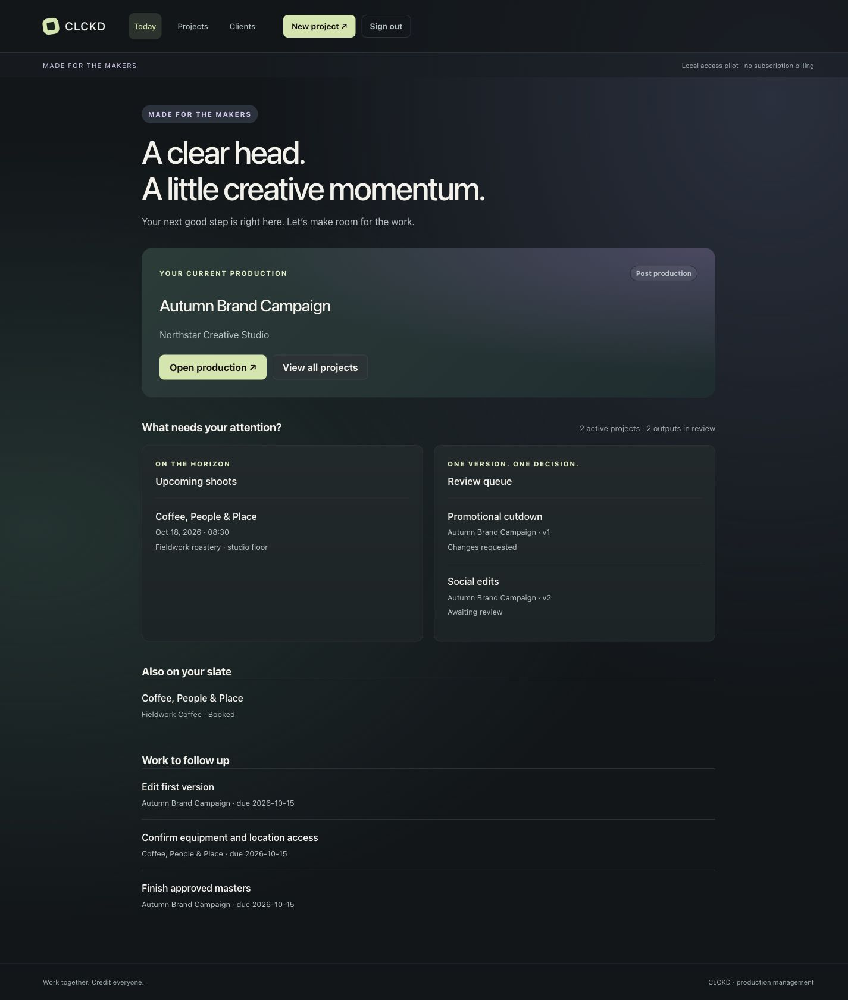

**A production desk, not another spreadsheet.** Keep the brief, shoot, outputs,
revisions and external payment schedule connected to the same project.
Open Today to see what needs attention; open a production to take its next step.

> **Working local application · active development.** One workspace owner with
> restricted local client-viewer access. Not a public multi-tenant SaaS, payment
> processor or digital-signature service. All screenshots use fictional data.

## The problem → one connected workflow

Creative work rarely stays in one place. Client details sit in a spreadsheet,
the brief in a document, shoot times in a message, feedback in another thread,
and payment reminders somewhere else. The difficult question becomes:
*what is the next agreed step, and what is it waiting on?*

CLCKD keeps that operational context together. Define the outputs and the
commercial milestones, plan production, preserve each submitted version,
record reported decisions, and track external handover without confusing
approval, delivery and payment.

## Core features

| Workspace | What is implemented |
| --- | --- |
| **Today** | Current production, upcoming shoots, outputs awaiting review or changes, and overdue tasks. |
| **Clients** | Contact details, linked projects, editing, duplicate confirmation and archive/restore workflows. |
| **Projects** | Production slate, guided creation, named approver, agreed scope and separate film/photography outputs. |
| **Shoot & Work** | Dated shoots with local call times, IANA timezones, locations and crew notes; tasks with priorities, deadlines and status updates. |
| **Outputs & Review** | Output specifications and quantities, included revision rounds, HTTPS review links, retained version history and operator-recorded approval/change requests. |
| **Delivery** | Version-specific external handover records; wrapping requires all active outputs to be delivered. Accidental approvals can be undone before delivery; later corrections remain in history. |
| **Commercial records** | Quotes and invoices within project details, plus 50/50, 30/30/40, equal-fifths or custom external payment schedules. Configured receipts can gate the app's production, editing and delivery steps. |
| **Client visibility** | Owner preview and expiring, revocable, one-use invitations for project-scoped read-only local access. Share selected submitted outputs and optionally payment terms. |

### From client relationship to production slate

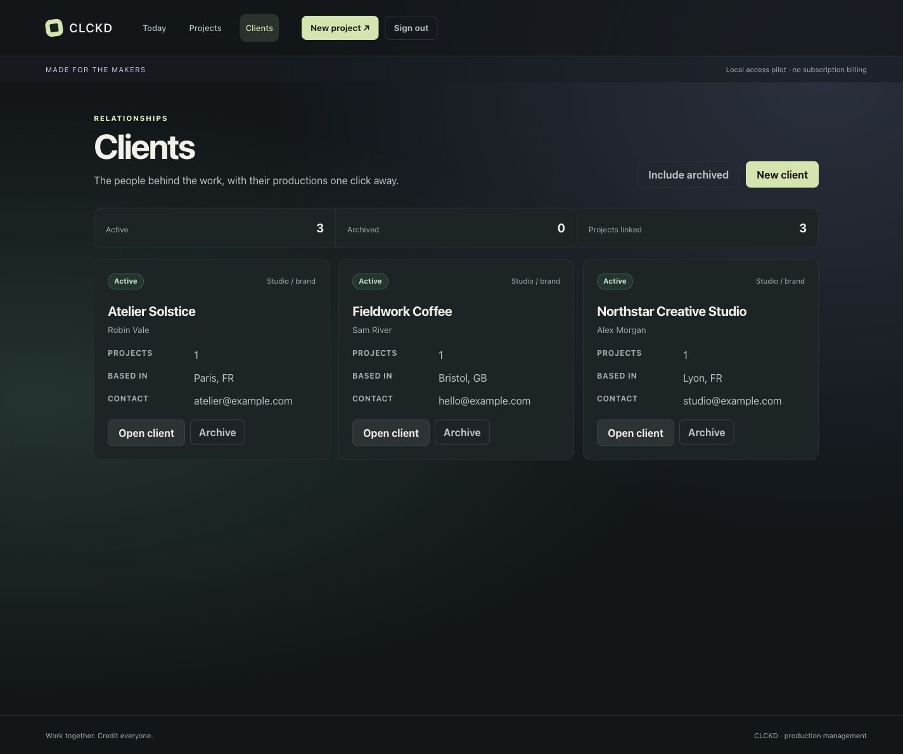

*Client records connect directly to their productions. Contact addresses use
the reserved example.com domain.*

<details>
<summary>See booked, in-progress and completed productions</summary>

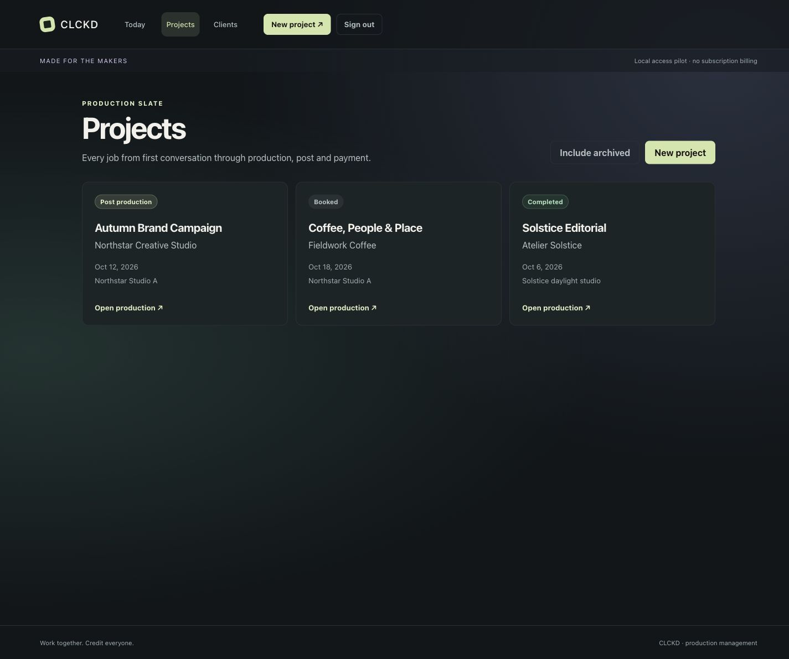

*Three fictional productions, with their actual stored statuses.*

</details>

### A brief the work can follow

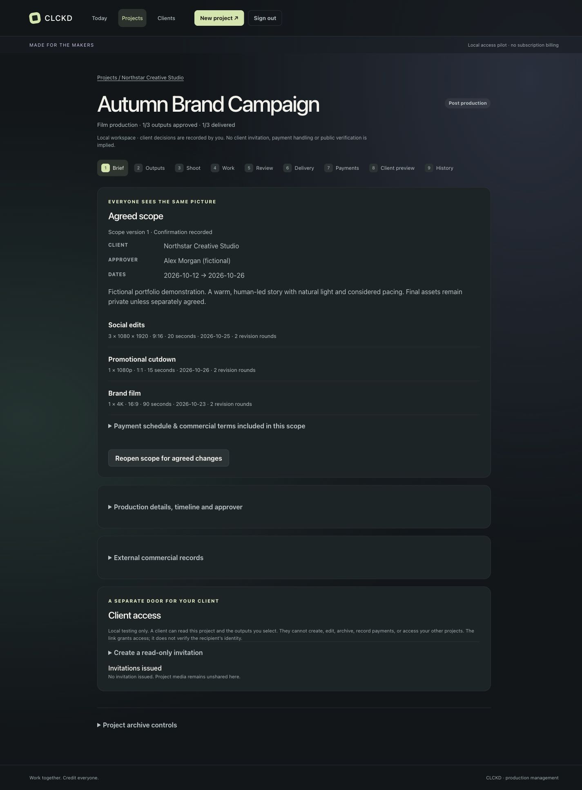

*The brief connects the approver, timeline and agreed outputs. Scope changes
invalidate the recorded confirmation rather than silently replacing it.*

<details>
<summary>Explore shoot planning and actionable tasks</summary>

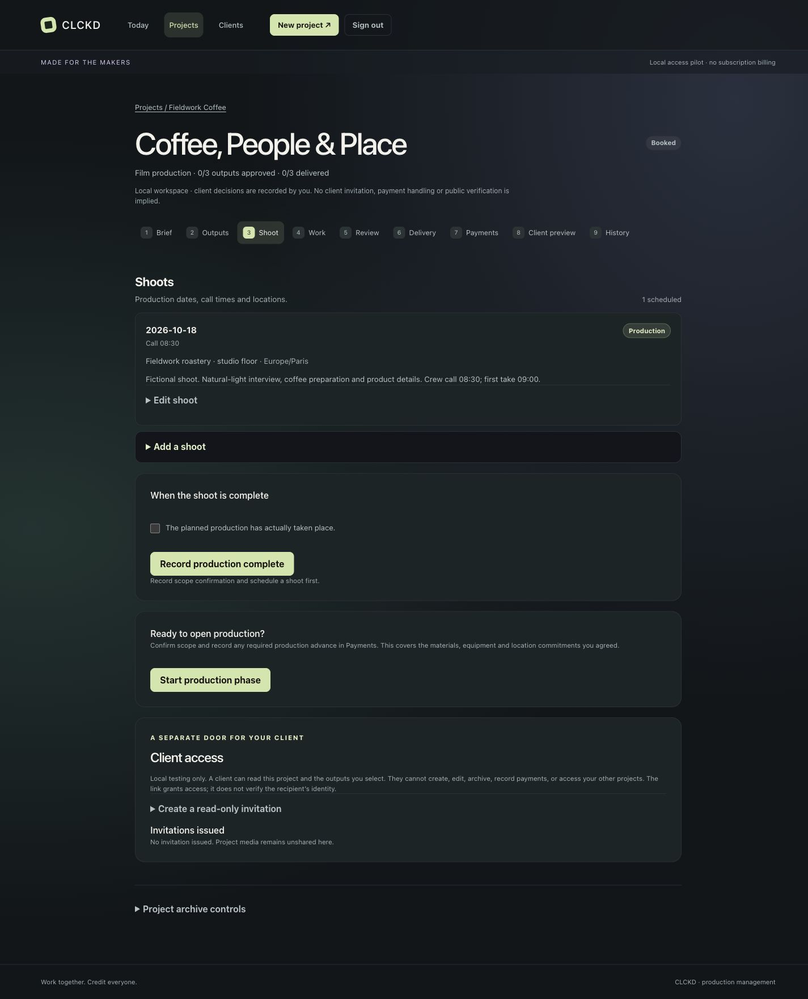

*Schedule a production day with location and crew context.*

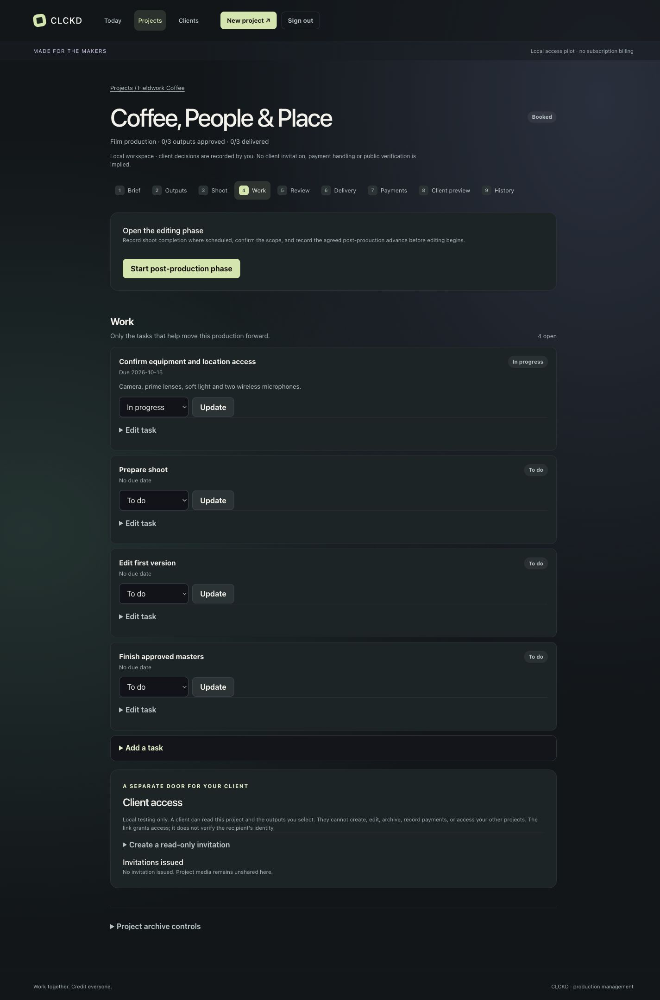

*Work stays inside its project, with concrete next actions.*

</details>

### One output. One version. One decision.

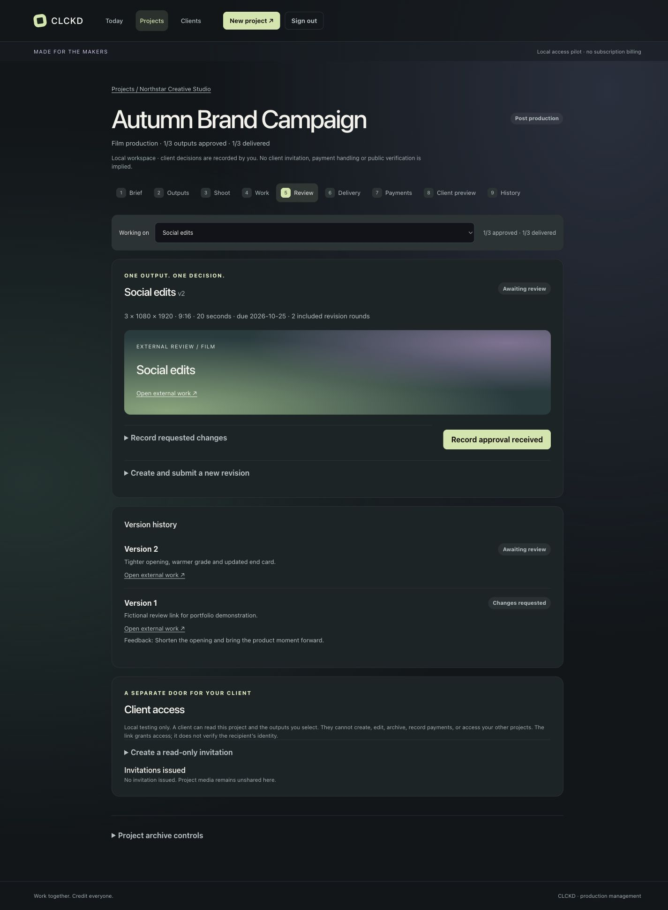

*Version 2 awaits review while version 1 retains its requested changes.
These are operator-entered records, not independently verified client decisions.*

<details>
<summary>See delivery records and the client-facing preview</summary>

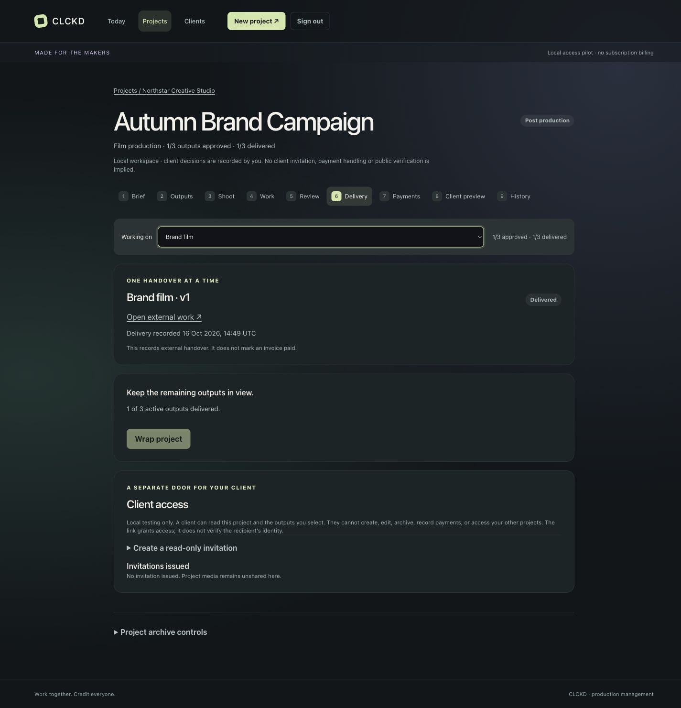

*This output was delivered; the other outputs keep the project open.
Delivery does not mark an invoice or milestone paid.*

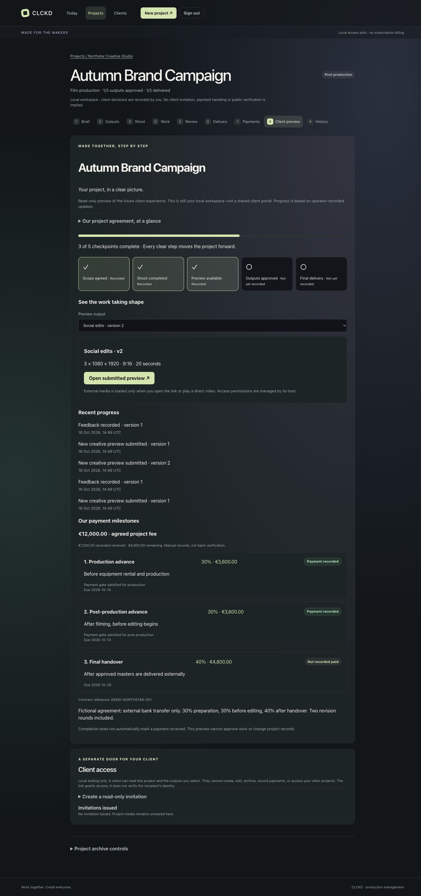

*The owner's Client preview tab shows recorded progress. This screenshot is
not a claimed guest session or a publicly shared portal.*

</details>

### Payment milestones, without handling money

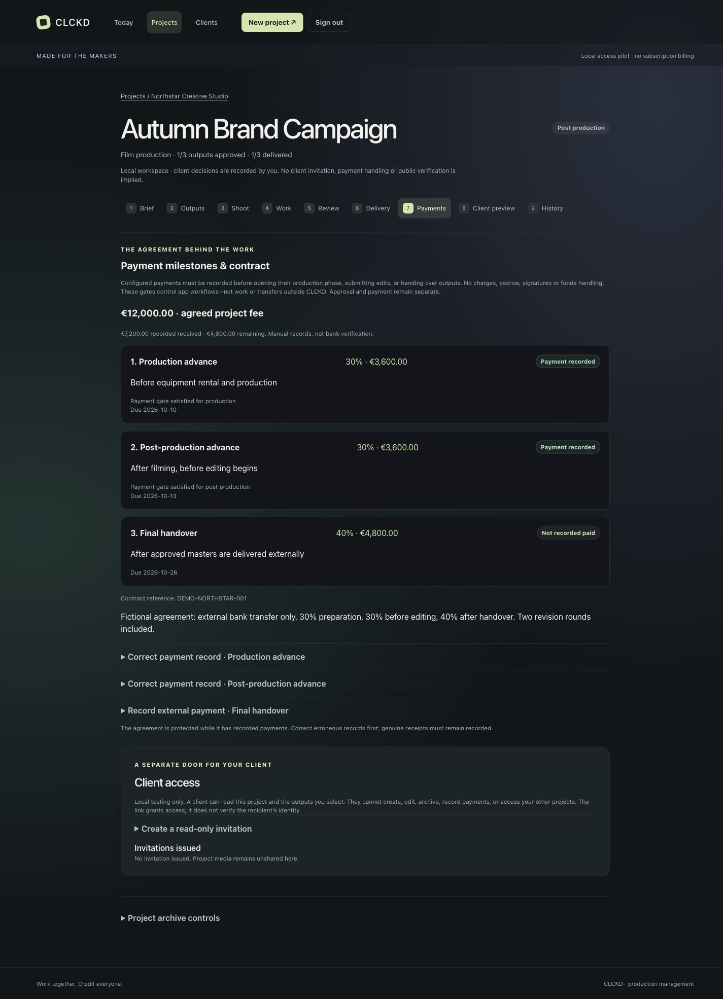

*The fictional €12,000 agreement records €7,200 received externally and €4,800
remaining. CLCKD neither moves nor verifies funds. Milestone records and
invoices are separate; there is no automatic reconciliation.*

<details>
<summary>See the responsive project slate</summary>

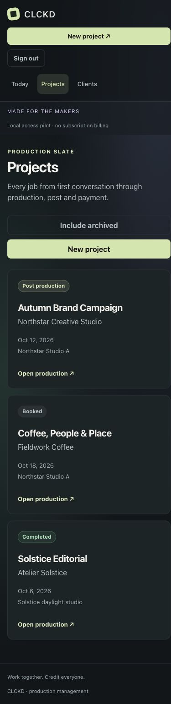

*Real browser capture at a 390 × 844 viewport, expanded to full page.
This is responsive web UI, not a native app.*

</details>

Capture conditions and visual verification limits are documented in
[the screenshot notes](docs/screenshots/README.md).

## How CLCKD works

**Client → Project → Production → Review → Delivery → Completion**

1. **Client:** select an existing relationship or create one during project setup.
2. **Project:** name the approver, define each output and optionally agree an
   external payment schedule. Record the scope confirmed outside CLCKD.
3. **Production:** plan shoots and tasks. Record any required external advances
   before opening their gated phase.
4. **Review:** submit an HTTPS-hosted version. Record approval received or
   requested changes; a new revision keeps the earlier version and its feedback.
5. **Delivery:** record external handover for each approved output version.
6. **Completion:** wrap when every active output has been delivered.
   Outstanding payments remain separate records.

## Architecture

A single Next.js application serves the UI and server-side application logic.
There is no separate backend service or remote database to provision.

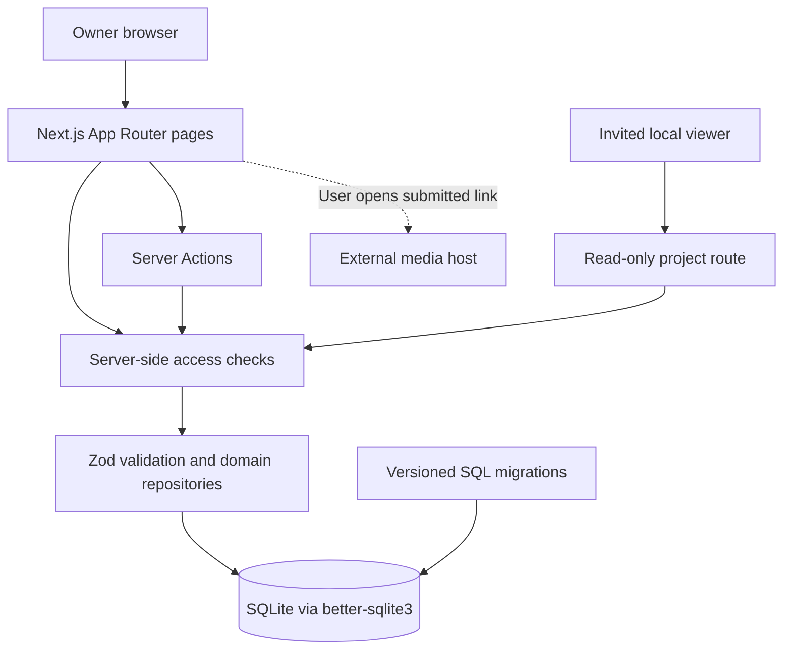

| Layer | Technology and responsibility |
| --- | --- |
| Interface | **Next.js 16, React 19, CSS Modules** — server-rendered pages and interactive project controls. |
| Application | **TypeScript, Server Actions, Zod** — validated mutations and domain-specific production rules. |
| Persistence | **SQLite / better-sqlite3** — local relational storage, foreign keys, WAL mode and transactional migrations. |
| Access | Local owner passphrase and server-checked sessions; scoped invitations for read-only viewers. |
| Verification | **Vitest**, strict TypeScript and ESLint; isolated temporary databases for integration tests. |

**Local-first means local storage, not cloud sync.** The default database is
`data/app.db`. Six paired SQL migrations are discovered and applied through
the existing migration runner. The explicit setup command initializes a fresh
database; application startup also applies pending migrations when it opens
the database. Back up existing data before upgrading.

Media stays on its external host. CLCKD stores links and version metadata,
not uploaded video files or transcoded previews. Opening external media
requires access to that host.

## Getting started

### Requirements

- **Node.js 22.23.3** and npm; use the repository's `.nvmrc` with an existing nvm installation.
- GitHub authentication with access to this currently private repository.
- No Odysseus, Docker, remote database, API keys or preconfigured credentials.

```bash
git clone --branch main https://github.com/fadel-santiago/CLCKD.git
cd CLCKD
nvm install
nvm use
npm ci
npm run setup:local
npm run dev
```

Open **[127.0.0.1:3300/access](http://127.0.0.1:3300/access)**.

Enter your name, the **actual setup code printed in your terminal**, and a
passphrase of at least 15 characters. The code is a one-time setup safeguard,
not your sign-in passphrase. Choose New project from Today to begin.

The setup command creates the database and private setup-code file. It does
**not** create an owner or seed demonstration data. Running it again preserves
existing data and credentials; once an owner exists it no longer prints the
code. Save your passphrase securely: built-in account recovery is not implemented.
Never delete the database to work around a forgotten passphrase.

### Optional configuration

No environment file is required. For overrides, copy
[.env.example](.env.example) to `.env.local`. Setup and Next.js load the same
environment files; explicit shell variables take precedence.

- `CLCKD_DB_PATH` changes the database location; the setup code lives beside it.
  Keep that location private and excluded from Git.
- Do not pin `NODE_ENV` in an environment file.
- Development and local production startup bind to `127.0.0.1:3300`.
  If occupied, use `npm run dev -- --port 3301` and open that port.
- For a production-mode **local** run, stop the dev server, run
  `npm run build`, then `npm start`. This does not enable public hosting.

### Native dependency troubleshooting

Install dependencies in the **same OS and Node version** used to run the app.
Do not share `node_modules` between macOS and Linux. A missing SQLite native
binding requires a fresh `npm ci` in the intended runtime. If no prebuilt
binary is available, compilation requires Python 3 and platform C/C++ tools
(Xcode Command Line Tools on macOS).

The clean-install verification used **macOS ARM64 with Node 22.23.3**.
Node 24.19.0 triggered a native SQLite cleanup assertion in the test suite;
use the pinned runtime. Other platforms have not received the same clean-install
verification.

## Testing and engineering quality

```bash
npm test
npm run typecheck
npm run lint
npm audit --omit=dev --audit-level=high
npm run build
```

**Recorded local baseline — 16 October 2026:** 222 tests across 15 files passed
in an isolated clean installation with Node 22.23.3 on macOS ARM64.
Typecheck, lint and production build passed; the production dependency audit
reported zero vulnerabilities at that checkpoint. These are recorded local
results, not a claim of continuous integration or a permanent security guarantee.

Engineering decisions represented in the source:

- Strict TypeScript and Zod input schemas; parameterized SQL.
- Transactional migration application with a schema-version ledger.
- Integer minor-unit money values; exact percentage allocation across milestones.
- Retained output versions and decision/correction history.
- Archive/restore rather than application-level hard deletion.
- Scrypt-hashed owner passphrases; opaque sessions in HttpOnly, SameSite=Strict cookies.
- Server-enforced owner mutations, matching-origin checks and project-scoped guest reads.

Tests use temporary databases. For manual experiments, set `CLCKD_DB_PATH`
to a separate temporary path for **both setup and startup**. Never seed, clear
or reuse the business database as a test fixture.

## Current scope and limitations

- **Local pilot, not launch-ready SaaS.** One owner; no public signup, tenant
  isolation, subscriptions, cloud sync or account recovery. Non-local request
  hosts are rejected. HTTP session cookies are designed for the localhost pilot,
  not public deployment.
- **Restricted viewers, not full collaborators.** One-use invitations expire and
  can be revoked, including their sessions. Viewers see their assigned project,
  selected submitted outputs and optionally commercial terms. They cannot manage
  projects, record payments or approve work. Public remote sharing is not enabled.
- **Records, not guarantees.** Scope confirmation and approvals are reported by
  the operator, not digital signatures or independently verified identities.
  No escrow, payment processing, automatic bank verification or work certificates.
- **External media.** Links do not confer publication rights, prevent downloads
  or replace the hosting provider's privacy/access controls. Screenshot review
  URLs are fictional placeholders, not playable demo films.
- **Focused modules.** Shoot planning and tasks are project-based. There is no
  standalone calendar or settings screen, complete equipment-checklist editor,
  or automated reconciliation between invoice and milestone records.
- **Verification boundaries.** Browser walkthroughs and integration tests do not
  establish public-deployment security, full accessibility conformance or
  exhaustive cross-device compatibility.

## Roadmap

| Horizon | Focus |
| --- | --- |
| **Implemented** | Connected local client/project workflow, production planning, versioned review, delivery, external payment milestones and restricted local access. |
| **Near term** | Broader clean-install checks, repeatable browser smoke tests, owner recovery design and tighter invoice/milestone clarity. |
| **Potential hosted release** | Separate security and tenancy design, hosted identity, subscription access, remote invitations, backups and operational monitoring. Not a commitment or supported deployment mode today. |

Reuse the existing application and domain model; prioritize a small,
reproducible workflow before expanding the platform.

## Project documentation

- [Product direction](docs/product-plan.md) — users, workflows and boundaries.
- [Data model](docs/data-model.md) — entities and technical invariants.
- [Implementation plan](docs/implementation-plan.md) — development phases.
- [Screenshot notes](docs/screenshots/README.md) — real capture provenance and limitations.
- [Agent rules](AGENTS.md) — repository working conventions.

## Author & portfolio

Built by **[Fadel Santiago](https://github.com/fadel-santiago)** as an independent
full-stack engineering portfolio application.

CLCKD demonstrates a connected product workflow backed by relational data,
validation, transactional state changes and tests. The screenshots show the
real local application with fictional records—not a static UI concept.
